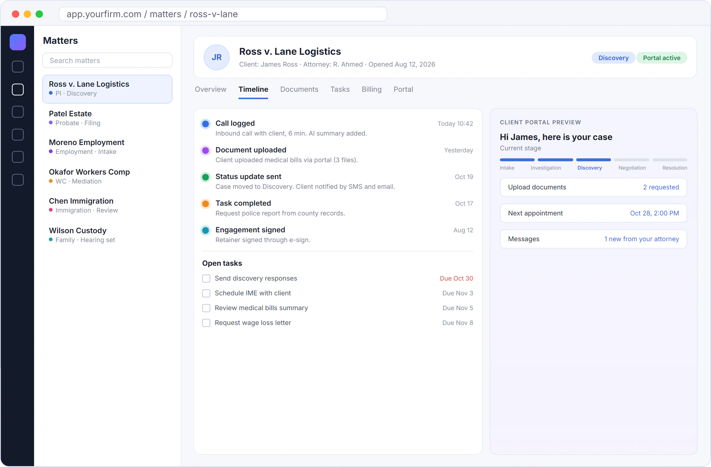
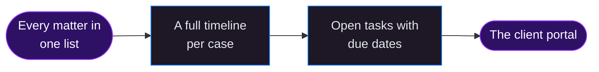

<!-- styled:v2 -->

**A custom CRM built around a law firm's intake and case process, with a branded portal where clients track their case and upload documents.**

  
  
  
  
  
  
  
  

  <a href="#overview">Overview</a> ·
  <a href="#how-it-works">How it works</a> ·
  <a href="#key-features">Key features</a> ·
  <a href="#results">Results</a> ·
  <a href="#screens">Screens</a> ·
  <a href="#tech-stack">Tech stack</a>

---

## Overview

Off-the-shelf CRMs did not match the firm's intake and case process. We built a custom-coded CRM and client portal around how the firm works: lead capture from the website and calls, custom intake pipeline stages, case records with secure document upload, a timeline of every call, document and update, and a portal where clients see their case stage, upload documents and message their attorney. Automated email and SMS reminders and reports reduce manual follow-up.

## The challenge

Generic CRMs forced the team to work around the software, and clients had no simple way to check their case or send documents.

## The solution

A React and Node.js CRM on PostgreSQL with custom pipeline stages, matter timelines and tasks, secure document upload, a branded client portal and n8n automations for reminders and reports.

## How it works

1. **Every matter in one list.** Matters are listed with their practice area and current stage, so the team sees the whole caseload at a glance.
2. **A full timeline per case.** Calls with AI summaries, uploaded documents, status updates and signed agreements appear in order.
3. **Open tasks with due dates.** Each matter has its own task list, with overdue items highlighted for the team.
4. **The client portal.** Clients see their case stage, upload requested documents, check appointments and message their attorney.

## Key features

- Lead capture from the website and calls
- Custom intake pipeline stages
- Case records with secure document upload
- Client portal for case status and messages
- Automated email and SMS reminders and reports

## Results

- One system that fits how the firm works
- Clients track their case without calling
- Less manual follow-up for the team

## Tech stack

     

## Screens

## Privacy

Client names and records are confidential. Every screen in this repository uses sample data, and source code that belongs to the client is not published.

## Links

- Case study on Lexvaxa: https://lexvaxa.com/work/law-firm-crm-client-portal

---

**Built by [Ch Muhammad Samiullah](https://github.com/samiullah156-creator)** · AI Automation Engineer and Full-Stack Developer at [Lexvaxa](https://lexvaxa.com)

⭐ Star this repo if you found it useful

